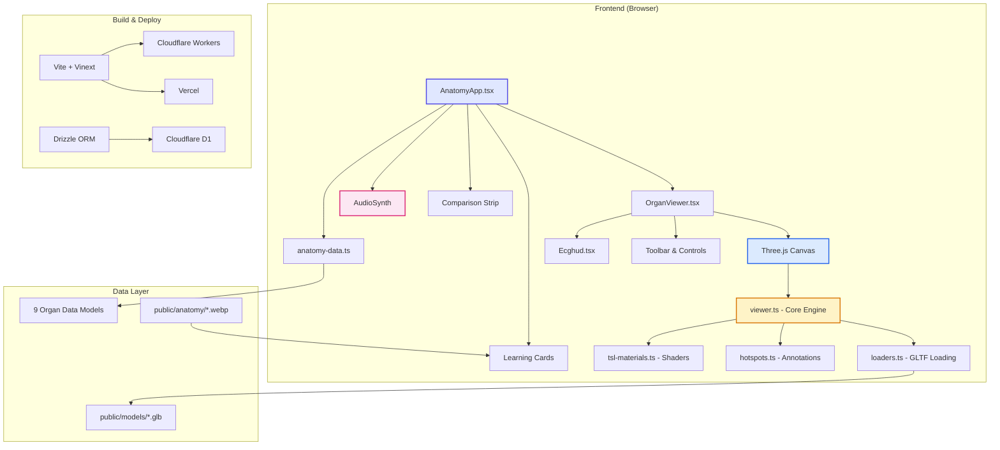
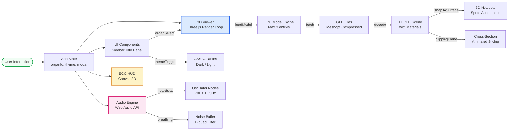

<div align="center">

# Anatomy Lab 3D

### Interactive 3D Human Anatomy Explorer

Developed & Maintained by **Rohit**

[](https://reactjs.org/)
[](https://nextjs.org/)
[](https://threejs.org/)
[](https://www.typescriptlang.org/)
[](https://tailwindcss.com/)
[](#)

An immersive, browser-based medical education platform featuring real-time 3D organ exploration, X-ray transparency, dissection views, live ECG monitoring, synthesized audio soundscapes, and interactive learning modules.

[](#)
[](#)

</div>

---

## Table of Contents

- [Overview](#overview)
- [Visual Architecture](#visual-architecture)
- [Key Features](#key-features)
- [3D Viewer Capabilities](#3d-viewer-capabilities)
- [Audio & Sound System](#audio--sound-system)
- [Learning & Quiz System](#learning--quiz-system)
- [Theming & UI Design](#theming--ui-design)
- [Responsive Layout](#responsive-layout)
- [Technology Stack](#technology-stack)
- [Project Structure](#project-structure)
- [Getting Started](#getting-started)
- [Deployment](#deployment)
- [Keyboard Shortcuts](#keyboard-shortcuts)
- [Contributing](#contributing)

---

## Overview

Anatomy Lab 3D is a high-performance, interactive web application designed for medical students, educators, and anatomy enthusiasts. It renders medically accurate 3D models of human organs in real-time using WebGL, providing an immersive learning experience directly in the browser.

```
  ┌─────────────────────────────────────────────────────────────────────┐
  │                     ANATOMY LAB 3D PLATFORM                        │
  ├────────────┬──────────────────────────────┬─────────────────────────┤
  │  ORGAN     │                              │    LEARNING             │
  │  LIBRARY   │      3D VIEWPORT             │    PANEL               │
  │            │                              │                         │
  │  ❤ Heart   │    ┌──────────────────┐      │  Name: Heart            │
  │  🧠 Brain  │    │                  │      │  System: Cardiovascular │
  │  🫁 Lungs  │    │   3D Organ       │      │  Size: 12cm x 8cm      │
  │  🫀 Liver  │    │   Model with     │      │  Weight: 300g          │
  │  🫘 Kidneys│    │   Hotspots &     │      │                         │
  │  👁 Eye    │    │   Annotations    │      │  ┌───────────────────┐  │
  │  🧬 Intest.│    │                  │      │  │  ECG Pulse HUD    │  │
  │  🟡 Pancre.│    └──────────────────┘      │  │  ~~~~~~^~~~~^~~~  │  │
  │  🔬 Skin   │                              │  └───────────────────┘  │
  │            │  [Rot][XRay][Cross][Expl]    │                         │
  └────────────┴──────────────────────────────┴─────────────────────────┘
```

---

## Visual Architecture

### System Architecture Diagram



### Data Flow Diagram



### Rendering Pipeline

```
┌─────────────────────────────────────────────────────────────────┐
│                    THREE.JS RENDER PIPELINE                      │
├─────────────────────────────────────────────────────────────────┤
│                                                                  │
│  ┌──────────┐   ┌──────────┐   ┌──────────┐   ┌──────────────┐ │
│  │ Scene    │──>│ Camera   │──>│ Renderer │──>│ Canvas Output│ │
│  │ Setup    │   │ 34° FOV  │   │ ACES     │   │ sRGB         │ │
│  └──────────┘   └──────────┘   │ Filmic   │   └──────────────┘ │
│       │                        │ Tone Map │                     │
│       v                        └──────────┘                     │
│  ┌──────────────────────────────────────┐                       │
│  │         LIGHTING SETUP               │                       │
│  │  • Ambient Light (base fill)         │                       │
│  │  • Hemisphere (sky/ground)           │                       │
│  │  • 3x Directional (key/fill/rim)    │                       │
│  │  • 2x Point Light (accent)          │                       │
│  │  • PMREM Gradient Environment Map    │                       │
│  └──────────────────────────────────────┘                       │
│       │                                                          │
│       v                                                          │
│  ┌──────────────────────────────────────┐                       │
│  │         POST-PROCESSING              │                       │
│  │  • Depth Prepass (transparency)      │                       │
│  │  • Local Clipping Planes            │                       │
│  │  • Material Roughness: 0.42-0.62     │                       │
│  │  • EnvMap Intensity: 0.32            │                       │
│  └──────────────────────────────────────┘                       │
│       │                                                          │
│       v                                                          │
│  ┌──────────────────────────────────────┐                       │
│  │         OPTIMIZATIONS                │                       │
│  │  • Render-on-demand (dirty flag)     │                       │
│  │  • IntersectionObserver culling      │                       │
│  │  • Pixel ratio capped at 2.0         │                       │
│  │  • LRU cache (max 3 models)          │                       │
│  └──────────────────────────────────────┘                       │
│                                                                  │
└─────────────────────────────────────────────────────────────────┘
```

---

## Key Features

### Interactive 3D Organ Viewer

Explore **9 medically accurate 3D organs** rendered in real-time with WebGL:

| Organ | System | Model | Accent |
|-------|--------|-------|--------|
| Heart | Cardiovascular | `heart.glb` | Coral |
| Brain | Nervous | `brain.glb` | Lavender |
| Lungs | Respiratory | `lungs.glb` | Sage |
| Liver | Digestive | `lungs.glb` | Amber |
| Kidneys | Urinary | `kidneys.glb` | Teal |
| Eyeball | Sensory | `eyeball.glb` | Violet |
| Intestine | Digestive | `intestine.glb` | Rose |
| Pancreas | Endocrine | `pancreas.glb` | Gold |
| Skin | Integumentary | `skin.glb` | Slate |

Each organ includes:
- **Scientific name** and body system classification
- **Physical stats** (size, weight, location)
- **Function** and daily activity facts
- **Blood supply** details
- **8 common medical conditions**
- **3D hotspot annotations** with anatomical labels

---

## 3D Viewer Capabilities

```
┌─────────────────────────────────────────────────────────────────┐
│                     VIEWER TOOLBAR                               │
├─────┬─────┬──────┬─────────┬──────────┬────────┬───────────────┤
│ Rot │ Zoom│ XRay │ Isolate │ Cross-Sec│ Layers │ Cinema │ Reset│
│  🔄 │  🔍 │  👻  │   🔲    │    ✂️    │  📐   │  🎬   │  ↩️  │
└─────┴─────┴──────┴─────────┴──────────┴────────┴───────────────┘

┌─────────────────────────────────────────────────────────────────┐
│                    ADVANCED CONTROLS                             │
├─────────────────────────────────────────────────────────────────┤
│                                                                  │
│  OPACITY SLIDER                                                  │
│  ├────○────────────────────────────────────────────┤             │
│  10%                                              100%          │
│                                                                  │
│  DISSECTION SLIDER                                               │
│  ├────○────────────────────────────────────────────┤             │
│  Intact                                    Fully Exploded        │
│                                                                  │
│  LIGHTING PRESETS                                                │
│  ┌──────────┐ ┌──────────┐ ┌──────────┐ ┌──────────┐           │
│  │ Clinical │ │Dark Neon │ │ X-Ray Blue│ │   Warm   │           │
│  │  (White) │ │  (Cyan)  │ │  (Blue)  │ │ (Amber)  │           │
│  └──────────┘ └──────────┘ └──────────┘ └──────────┘           │
│                                                                  │
└─────────────────────────────────────────────────────────────────┘
```

### X-Ray Transparency Mode

```
   OPAQUE (100%)              X-RAY (50%)              WIREFRAME
  ┌──────────────┐          ┌──────────────┐          ┌──────────────┐
  │ ████████████ │          │ ▓▓▓░░░▓▓▓░░░ │          │ ╱╲╱╲╱╲╱╲╱╲  │
  │ ████████████ │   ──>    │ ▓░░░▓▓░░░▓▓░ │   ──>    │ ╲╱╲╱╲╱╲╱╲╱  │
  │ ████████████ │          │ ░░▓▓░░░▓▓░░░ │          │ ╱╲╱╲╱╲╱╲╱╲  │
  │ ████████████ │          │ ▓▓░░░▓▓░░░▓▓ │          │ ╲╱╲╱╲╱╲╱╲╱  │
  └──────────────┘          └──────────────┘          └──────────────┘
   Full surface              Translucent with          Mesh topology
   rendering                  depth prepass             visualization
```

### Cross-Section & Dissection

```
  INTACT                    CROSS-SECTION              EXPLODED VIEW
  ┌──────────────┐          ┌──────────────┐          ┌──────────────┐
  │ ┌──────────┐ │          │ ┌──────────┐ │          │ ┌──────────┐ │
  │ │          │ │          │ │    ╱╱    │ │          │ │          │ │
  │ │  Organ   │ │   ──>    │ │   ╱╱     │ │   ──>   │ └──────────┘ │
  │ │          │ │          │ │  ╱╱      │ │          │              │
  │ └──────────┘ │          │ └──────────┘ │          │ ┌──────────┐ │
  └──────────────┘          └──────────────┘          │ └──────────┘ │
                                                      └──────────────┘
   Full model               Animated clipping         Sub-meshes
                            plane reveals              separated
                            internal structure         for inspection
```

### 3D Hotspot Annotation System

```
                    ┌─ [label] ──────────────────┐
                    │  "Aorta"                    │
                    │  "The largest artery in     │
                    │   the body, carrying blood  │
                    │   from the heart."          │
                    └────────────────────────────┘
                              │
                              ▼
                         ┌────────┐
                         │   ●    │  ◄── Sprite dot with halo
                         │  ╱│╲   │      + ring pulse animation
                         │ ╱ │ ╲  │
                         └────────┘
                              │
                              ▼
                    ┌──────────────────┐
                    │   3D ORGAN       │
                    │   MODEL          │
                    │                  │
                    │  Surface-snapped │
                    │  annotations     │
                    │  with direction  │
                    │  cone filtering  │
                    └──────────────────┘
```

**Hotspot Features:**
- Canvas-rendered sprite textures (dot + halo + ring pulse)
- `snapToSurface()`: Projects 3D positions onto nearest mesh vertices
- Direction-cone filtering (4 tiers: 0.94, 0.82, 0.6, -1.1) prevents backside snapping
- Per-frame facing test with smoothstep opacity fade
- View-lift along camera ray (0.3 units) for readability
- Screen-space picking with 24px hit radius
- Constant on-screen pixel size regardless of zoom level

---

## Audio & Sound System

```
┌─────────────────────────────────────────────────────────────────┐
│                    AUDIO SYNTH ENGINE                            │
├─────────────────────────────────────────────────────────────────┤
│                                                                  │
│  ┌─────────────────┐     ┌─────────────────┐                    │
│  │   HEARTBEAT     │     │   BREATHING     │                    │
│  │   SYNTHESIZER   │     │   SYNTHESIZER   │                    │
│  ├─────────────────┤     ├─────────────────┤                    │
│  │ Osc 1: 70 Hz    │     │ White Noise      │                    │
│  │ Osc 2: 55 Hz    │     │ Buffer           │                    │
│  │                 │     │                  │                    │
│  │ lub ── dub      │     │ Inhale: Lowpass  │                    │
│  │  │      │       │     │ Exhale: Bandpass │                    │
│  │  ▼      ▼       │     │                  │                    │
│  │ Exp. freq ramp  │     │ 4-second cycle   │                    │
│  │                 │     │ Volume envelope   │                    │
│  │ Configurable    │     │                  │                    │
│  │ BPM (default 72)│     │                  │                    │
│  └─────────────────┘     └─────────────────┘                    │
│                                                                  │
│  ┌─────────────────┐     ┌─────────────────┐                    │
│  │   UI CLICK      │     │   VOICEOVER     │                    │
│  │   FEEDBACK      │     │   (TTS)         │                    │
│  ├─────────────────┤     ├─────────────────┤                    │
│  │ Triangle Wave   │     │ Web Speech API   │                    │
│  │ 800 → 200 Hz    │     │ SpeechSynthesis  │                    │
│  │ 40ms decay      │     │ Rate: 0.95       │                    │
│  └─────────────────┘     │ Pitch: 1.0       │                    │
│                          └─────────────────┘                    │
│                                                                  │
│  ┌─────────────────────────────────────────────────────────┐    │
│  │  MUTE TOGGLE: Global on/off for all audio               │    │
│  │  Ambient sounds start/stop per organ selection           │    │
│  └─────────────────────────────────────────────────────────┘    │
│                                                                  │
└─────────────────────────────────────────────────────────────────┘
```

### Heartbeat Waveform Visualization

```
Voltage
  │
  │         R
  │        ╱╲        T
  │       ╱  ╲      ╱╲
  │  P    ╱    ╲    ╱  ╲
  │ ╱╲   ╱      ╲  ╱    ╲
  │╱  ╲ ╱        ╲╱      ╲────────────
  ├──────────────────────────────────── Time
  │ Q    S
  │╱╲  ╱╲
  │  ╲╱  ╲
  │
  └─── P-QRST Complex (Heart) ────────
  
  vs.
  
  │    ╭─╮   ╭─╮   ╭─╮   ╭─╮
  │───╯  ╰──╯  ╰──╯  ╰──╯  ╰───────
  │
  └─── Sine Pulse (Other Organs) ─────
```

---

## Learning & Quiz System

### Learning Modals

```
┌─────────────────────────────────────────────────────────────────┐
│                    MODAL SYSTEM                                  │
├─────────────────────────────────────────────────────────────────┤
│                                                                  │
│  ┌──────────────┐  ┌──────────────┐  ┌──────────────┐          │
│  │   LESSON     │  │    QUIZ      │  │   SYSTEM     │          │
│  │   MODAL      │  │   MODAL      │  │   MODAL      │          │
│  ├──────────────┤  ├──────────────┤  ├──────────────┤          │
│  │ Guided       │  │ 2 questions  │  │ Organ        │          │
│  │ discovery    │  │ per organ    │  │ placement    │          │
│  │ with         │  │              │  │ within       │          │
│  │ animated     │  │ Correct:     │  │ body system  │          │
│  │ organ        │  │  +100 XP     │  │              │          │
│  │ illustration │  │              │  │ Key facts:   │          │
│  │              │  │ Incorrect:   │  │ • System     │          │
│  │              │  │  Try again   │  │ • Role       │          │
│  │              │  │              │  │ • Blood      │          │
│  │              │  │ Voiceover    │  │   supply     │          │
│  │              │  │ feedback     │  │              │          │
│  └──────────────┘  └──────────────┘  └──────────────┘          │
│                                                                  │
│  ┌──────────────┐  ┌──────────────┐                             │
│  │  ANIMATION   │  │    NOTES     │                             │
│  │   MODAL      │  │    MODAL     │                             │
│  ├──────────────┤  ├──────────────┤                             │
│  │ Function     │  │ Personal     │                             │
│  │ animation    │  │ study notes  │                             │
│  │ with         │  │ textarea     │                             │
│  │ heartbeat    │  │ editor       │                             │
│  │ pulse        │  │              │                             │
│  │              │  │ Export to    │                             │
│  │              │  │ .txt file    │                             │
│  └──────────────┘  └──────────────┘                             │
│                                                                  │
└─────────────────────────────────────────────────────────────────┘
```

### Learning Cards Grid

```
┌─────────────────────────────────────────────────────────────────┐
│                    LEARNING CARDS (6-Card Grid)                  │
├─────────────┬─────────────┬─────────────┬───────────────────────┤
│             │             │             │                       │
│  Curiosity  │ Microscopic │   Organ     │   Function            │
│    Card     │    View     │ Comparison  │   Animation           │
│             │             │             │                       │
│  Fun facts  │  Tissue     │ Heart vs    │   Animated            │
│  & trivia   │  structure  │ Brain       │   heartbeat           │
│             │             │             │   visualization       │
├─────────────┼─────────────┼─────────────┼───────────────────────┤
│             │             │             │                       │
│  Clinical   │    Body     │             │                       │
│   Notes     │   System    │             │                       │
│             │  Placement  │             │                       │
│             │             │             │                       │
│  8 common   │  Anatomical │             │                       │
│ conditions  │  position   │             │                       │
│             │             │             │                       │
└─────────────┴─────────────┴─────────────┴───────────────────────┘
```

### Organ Comparison Strip

```
┌─────────────────────────────────────────────────────────────────┐
│                 ORGAN COMPARISON STRIP                           │
├───────────────────────────┬─────────────────────────────────────┤
│         HEART             │            BRAIN                    │
├───────────────────────────┼─────────────────────────────────────┤
│ ❤ Cardiovascular System   │  🧠 Nervous System                  │
│                           │                                     │
│ Pumps blood through the   │ Controls thoughts, memory, and     │
│ circulatory system        │ bodily functions                    │
│                           │                                     │
│ Size: 12cm x 8cm         │ Size: 15cm x 14cm                   │
│ Weight: 300g             │ Weight: 1.4 kg                      │
│                           │                                     │
│ Beats ~100,000 times/day  │ Processes ~86 billion neurons       │
└───────────────────────────┴─────────────────────────────────────┘
```

---

## Theming & UI Design

### CSS Custom Properties System

```css
/* ═══════════════════════════════════════════════════════════════ */
/*  DESIGN TOKENS - Light Theme (Default)                         */
/* ═══════════════════════════════════════════════════════════════ */
:root {
  /* Primary Palette */
  --ink:     #1a1a2e;    /* Deep navy - text */
  --canvas:  #f8f9fa;    /* Off-white - background */
  --paper:   #ffffff;    /* Pure white - cards */
  
  /* Accent Colors */
  --coral:   #ff6b6b;    /* Heart, CTAs */
  --lavender:#a29bfe;    /* Brain, secondary */
  --sage:    #55efc4;     /* Lungs, success */
  
  /* Glassmorphism */
  --glass-bg: rgba(255, 255, 255, 0.72);
  --glass-blur: blur(20px);
  --glass-border: rgba(255, 255, 255, 0.18);
  
  /* Transitions */
  --transition-speed: 0.3s;
  --ease-out: cubic-bezier(0.25, 0.46, 0.45, 0.94);
}

/* ═══════════════════════════════════════════════════════════════ */
/*  DESIGN TOKENS - Dark Theme                                    */
/* ═══════════════════════════════════════════════════════════════ */
html[data-theme="dark"] {
  --ink:     #e2e8f0;    /* Light gray - text */
  --canvas:  #0f0f23;    /* Deep space - background */
  --paper:   #1a1a2e;    /* Dark navy - cards */
  
  --coral:   #ff7675;    /* Softer coral */
  --lavender:#b8b5ff;    /* Brighter lavender */
  --sage:    #7bed9f;     /* Brighter sage */
  
  --glass-bg: rgba(15, 15, 35, 0.78);
  --glass-border: rgba(255, 255, 255, 0.08);
}
```

### Theme Comparison

```
┌─────────────────────────────────────────────────────────────────┐
│                    LIGHT THEME                                   │
├─────────────────────────────────────────────────────────────────┤
│  ┌────────────────────────────────────────────────────────┐     │
│  │  Background: #f8f9fa (Off-white)                       │     │
│  │                                                        │     │
│  │  ┌──────────────┐  ┌──────────────┐  ┌──────────────┐ │     │
│  │  │ Card: #fff   │  │ Card: #fff   │  │ Card: #fff   │ │     │
│  │  │ Text: #1a1a2e│  │ Text: #1a1a2e│  │ Text: #1a1a2e│ │     │
│  │  │ Accent:#ff6b │  │ Accent:#a29b │  │ Accent:#55ef │ │     │
│  │  └──────────────┘  └──────────────┘  └──────────────┘ │     │
│  │                                                        │     │
│  │  Glass: rgba(255,255,255,0.72) + blur(20px)          │     │
│  └────────────────────────────────────────────────────────┘     │
│  Warm studio lighting feel                                       │
└─────────────────────────────────────────────────────────────────┘

┌─────────────────────────────────────────────────────────────────┐
│                    DARK THEME                                    │
├─────────────────────────────────────────────────────────────────┤
│  ┌────────────────────────────────────────────────────────┐     │
│  │  Background: #0f0f23 (Deep space)                      │     │
│  │                                                        │     │
│  │  ┌──────────────┐  ┌──────────────┐  ┌──────────────┐ │     │
│  │  │ Card: #1a1a2e│  │ Card: #1a1a2e│  │ Card: #1a1a2e│ │     │
│  │  │ Text: #e2e8f0│  │ Text: #e2e8f0│  │ Text: #e2e8f0│ │     │
│  │  │ Accent:#ff76 │  │ Accent:#b8b5 │  │ Accent:#7bed │ │     │
│  │  └──────────────┘  └──────────────┘  └──────────────┘ │     │
│  │                                                        │     │
│  │  Glass: rgba(15,15,35,0.78) + blur(20px)             │     │
│  └────────────────────────────────────────────────────────┘     │
│  High-contrast surgical precision feel                           │
└─────────────────────────────────────────────────────────────────┘
```

---

## Responsive Layout

```
┌─────────────────────────────────────────────────────────────────┐
│                    DESKTOP (1720px max)                          │
├────────────┬──────────────────────────────┬─────────────────────┤
│  SIDEBAR   │       3D VIEWER              │     INFO PANEL      │
│  285px     │       flex-3                 │     330px           │
│            │                              │                     │
│  Search    │     ┌────────────────┐       │  Organ Details      │
│  Organ     │     │                │       │  System Info        │
│  List      │     │   3D Canvas    │       │  ECG HUD           │
│            │     │                │       │  Learning Cards     │
│            │     └────────────────┘       │                     │
│            │     [Toolbar]                │                     │
└────────────┴──────────────────────────────┴─────────────────────┘

┌─────────────────────────────────────────────────────────────────┐
│                    TABLET (< 1350px)                             │
├────────────┬──────────────────────────────┬─────────────────────┤
│  SIDEBAR   │       3D VIEWER              │     INFO PANEL      │
│  Condensed │       Condensed              │     Condensed       │
│  (hidden   │                              │                     │
│   search)  │                              │                     │
└────────────┴──────────────────────────────┴─────────────────────┘

┌─────────────────────────────────────────────────────────────────┐
│                    MOBILE (< 760px)                              │
├─────────────────────────────────────────────────────────────────┤
│  ┌─────────────────────────────────────────────────────────┐   │
│  │                    3D VIEWER                             │   │
│  │                    (Full Width)                          │   │
│  │                    [Bottom Toolbar]                      │   │
│  └─────────────────────────────────────────────────────────┘   │
│  ┌─────────────────────────────────────────────────────────┐   │
│  │              ORGAN LIBRARY (Bottom Drawer)               │   │
│  │              Scrollable horizontal list                  │   │
│  └─────────────────────────────────────────────────────────┘   │
│  ┌─────────────────────────────────────────────────────────┐   │
│  │                    INFO PANEL                            │   │
│  │                    (Stacked below)                       │   │
│  └─────────────────────────────────────────────────────────┘   │
└─────────────────────────────────────────────────────────────────┘
```

### Breakpoint System

| Breakpoint | Width | Behavior |
|------------|-------|----------|
| Desktop | 1720px max | Full 3-column layout |
| Tablet | < 1350px | Condensed columns, search hidden |
| Small Tablet | < 1040px | Nav labels hidden, info panel full width |
| Mobile | < 760px | Bottom drawer for library, stacked layout |
| Small Mobile | < 470px | Single column, tip note hidden |
| Reduced Motion | `prefers-reduced-motion` | Disables animations |

---

## Technology Stack

```
┌─────────────────────────────────────────────────────────────────┐
│                    TECHNOLOGY STACK                              │
├─────────────────────────────────────────────────────────────────┤
│                                                                  │
│  FRONTEND                                                        │
│  ├── React 19.2.6 ............. UI Component Framework          │
│  ├── Next.js 16.2.6 ........... SSR / React Server Components   │
│  ├── Vinext 0.0.50 ............ Edge Runtime (Cloudflare)       │
│  ├── Three.js 0.185.1 ......... WebGL 3D Rendering              │
│  │   ├── GLTFLoader ........... 3D Model Loading                │
│  │   ├── MeshoptDecoder ....... Mesh Compression                │
│  │   ├── OrbitControls ........ Camera Interaction              │
│  │   └── PMREM ............... Environment Mapping              │
│  ├── GSAP 3.15.0 .............. Animation & Tweening            │
│  ├── TypeScript 5.9.3 ......... Type Safety                     │
│  └── TailwindCSS 4.2.1 ........ Utility-First CSS               │
│                                                                  │
│  STYLING                                                         │
│  ├── Custom CSS (874 lines) ... Complete Design System           │
│  │   ├── CSS Custom Properties  Theme Tokens                    │
│  │   ├── Glassmorphism ......... Backdrop Blur Effects           │
│  │   ├── @keyframes ............ 7 Animation Definitions        │
│  │   └── 5 Responsive Breakpoints                               │
│  └── Lucide React 1.28.0 ...... SVG Icon Library                │
│                                                                  │
│  BUILD & DEPLOY                                                  │
│  ├── Vite 8.0.13 .............. Build Tool & Dev Server         │
│  ├── Cloudflare Vite Plugin ... Workers Integration             │
│  ├── Wrangler 4.92.0 .......... Cloudflare CLI                  │
│  └── Node.js >= 22.13.0 ...... Runtime                          │
│                                                                  │
│  DATABASE (Optional)                                             │
│  ├── Drizzle ORM 0.45.2 ....... SQL ORM                         │
│  ├── Drizzle Kit 0.31.10 ...... Migrations                      │
│  └── Cloudflare D1 ............. SQLite Edge Database            │
│                                                                  │
│  AUDIO & SPEECH                                                  │
│  ├── Web Audio API ............. Synthesized Soundscapes         │
│  └── Web Speech API ............ Text-to-Speech Voiceovers       │
│                                                                  │
└─────────────────────────────────────────────────────────────────┘
```

---

## Project Structure

```
anatomy/
├── app/                              # Next.js App Router
│   ├── page.tsx                      # Root page → <AnatomyApp />
│   ├── layout.tsx                    # Root layout, fonts, metadata
│   ├── globals.css                   # Complete CSS design system (874 lines)
│   │
│   ├── components/
│   │   ├── AnatomyApp.tsx            # Main shell, state, modals (469 lines)
│   │   ├── OrganViewer.tsx           # 3D viewer wrapper + toolbar (290 lines)
│   │   └── Ecghud.tsx                # Real-time ECG/pulse canvas (83 lines)
│   │
│   └── lib/
│       ├── anatomy-data.ts           # 9 organ data models (311 lines)
│       ├── audio-synth.ts            # Web Audio synthesizer (162 lines)
│       └── three/
│           ├── viewer.ts             # Core Three.js engine (701 lines)
│           ├── loaders.ts            # GLTF loader + LRU cache (213 lines)
│           ├── hotspots.ts           # 3D annotation system (371 lines)
│           ├── tsl-materials.ts      # Shader nodes (8 lines)
│           └── dispose.ts            # Disposal utilities (15 lines)
│
├── public/
│   ├── models/                       # 9 .glb 3D organ models
│   │   ├── heart.glb
│   │   ├── brain.glb
│   │   ├── lungs.glb
│   │   ├── liver.glb
│   │   ├── kidneys.glb
│   │   ├── eyeball.glb
│   │   ├── intestine.glb
│   │   ├── pancreas.glb
│   │   └── skin.glb
│   │
│   ├── anatomy/                      # 2D organ illustrations (WebP)
│   │   └── {organ}/
│   │       ├── thumb.webp
│   │       ├── organ.webp
│   │       ├── microscopic.webp
│   │       ├── location.webp
│   │       └── compare.webp
│   │
│   ├── draco/                        # Draco mesh decoder (WASM)
│   └── basis/                        # Basis texture transcoder (WASM)
│
├── worker/
│   └── index.ts                      # Cloudflare Worker entry (47 lines)
│
├── db/
│   ├── index.ts                      # D1 connection via Drizzle
│   └── schema.ts                     # Database schema
│
├── tests/
│   └── rendered-html.test.mjs        # Integration test
│
├── vite.config.ts                    # Vite + Vinext + Cloudflare config
├── next.config.ts                    # Next.js config
├── drizzle.config.ts                 # Drizzle Kit config
├── postcss.config.mjs                # PostCSS (TailwindCSS)
└── package.json
```

---

## Getting Started

### Prerequisites

- **Node.js** `>= 22.13.0`
- **npm** or **yarn** or **pnpm**

### Installation

```bash
# Clone the repository
git clone https://github.com/your-username/anatomy-lab-3d.git
cd anatomy-lab-3d

# Install dependencies
npm install

# Start development server
npm run dev
```

Open [http://localhost:5173](http://localhost:5173) in your browser.

### Available Scripts

| Command | Description |
|---------|-------------|
| `npm run dev` | Start local dev server (Cloudflare Workers) |
| `npm run build` | Build for production (Cloudflare Workers) |
| `npm run build:next` | Build for Vercel deployment |
| `npm run start` | Start production server |
| `npm test` | Run integration tests |
| `npm run lint` | Lint source code |
| `npm run db:generate` | Generate database migrations |

---

## Deployment

### Cloudflare Workers (Primary)

```bash
# Build and deploy
npm run build
npx wrangler deploy
```

**Features:**
- Edge runtime via Vinext
- `nodejs_compat` flag
- Optional D1/R2 bindings

### Vercel (Alternative)

```bash
# Build for Vercel
npm run build:next

# Deploy via Vercel CLI
npx vercel --prod
```

**Configuration:** See `vercel.json`

### OpenAI Hosting

Metadata in `.openai/hosting.json` with custom Vite plugin for build output.

---

## Keyboard Shortcuts

| Key | Action |
|-----|--------|
| `←` `→` | Rotate organ left/right |
| `↑` `↓` | Tilt organ up/down |
| `+` / `-` | Zoom in/out |
| `Escape` | Deselect organ |
| `R` | Toggle auto-rotate |
| `X` | Toggle X-ray mode |
| `C` | Toggle cross-section |

---

## Performance Optimizations

```
┌─────────────────────────────────────────────────────────────────┐
│                    PERFORMANCE FEATURES                          │
├─────────────────────────────────────────────────────────────────┤
│                                                                  │
│  RENDERING                                                       │
│  ├── Render-on-demand (dirty flag)                              │
│  │   Only re-renders when scene changes                         │
│  ├── IntersectionObserver culling                               │
│  │   Skips rendering when off-screen                             │
│  ├── visibilitychange listener                                  │
│  │   Pauses when tab is hidden                                   │
│  ├── Pixel ratio capped at 2.0 (1.5 on mobile)                  │
│  │   Prevents excessive GPU load                                 │
│  └── ACES Filmic tone mapping                                    │
│      Efficient color grading                                     │
│                                                                  │
│  LOADING                                                         │
│  ├── LRU cache (max 3 models)                                   │
│  │   Keeps most recent models in memory                          │
│  ├── Meshopt compression                                         │
│  │   Smaller GLB files, faster downloads                         │
│  ├── Low-priority prefetch                                       │
│  │   Background loading before selection                         │
│  └── Progressive loading indicator                               │
│      Orbital spinner with percentage                             │
│                                                                  │
│  MATERIALS                                                       │
│  ├── Roughness clamped (0.42-0.62)                              │
│  │   Consistent lighting response                                │
│  ├── Zero metalness                                              │
│  │   Prevents unrealistic reflections                            │
│  ├── Low envMap intensity (0.32)                                 │
│  │   Subtle environment influence                                 │
│  └── Anisotropic filtering on textures                           │
│      Sharp at oblique angles                                     │
│                                                                  │
│  ANIMATION                                                       │
│  ├── GSAP back-ease transitions                                  │
│  │   Smooth organ entry/exit                                     │
│  ├── Reduced motion support                                      │
│  │   Respects prefers-reduced-motion                             │
│  └── Auto-rotate with pause-on-interaction                       │
│      3-second cooldown after user input                          │
│                                                                  │
└─────────────────────────────────────────────────────────────────┘
```

---

## Accessibility

- **Reduced Motion**: All animations respect `prefers-reduced-motion` media query
- **Keyboard Navigation**: Full keyboard support for all viewer controls
- **High Contrast**: Both themes maintain WCAG AA contrast ratios
- **Semantic HTML**: Proper ARIA labels and roles
- **Focus Indicators**: Visible focus states for interactive elements

---

## Testing

```bash
# Run the integration test
npm test
```

**Test Coverage:**
- HTML rendering verification
- Correct `<title>` element
- Presence of "Anatomy Lab 3D" and "Developed by Rohit"
- 200 status code response
- Correct `text/html` content type

---

## Contributing

Contributions are welcome! Please follow these steps:

1. Fork the repository
2. Create a feature branch (`git checkout -b feature/amazing-feature`)
3. Commit your changes (`git commit -m 'Add amazing feature'`)
4. Push to the branch (`git push origin feature/amazing-feature`)
5. Open a Pull Request

### Development Guidelines

- Follow TypeScript strict mode
- Use existing CSS custom properties for theming
- Maintain responsive design across all breakpoints
- Add keyboard shortcuts for new features
- Update documentation for API changes

---

## License

This project is licensed under the MIT License - see the [LICENSE](LICENSE) file for details.

---

## Acknowledgments

- **Three.js** - WebGL 3D rendering engine
- **React** - UI component library
- **Next.js** - React meta-framework
- **GSAP** - Animation library
- **TailwindCSS** - Utility-first CSS framework
- **Cloudflare** - Edge deployment platform
- **Web Audio API** - Browser audio synthesis
- **Web Speech API** - Text-to-speech capabilities

---

<div align="center">

**Built with passion for medical education**

Developed by **Rohit**

[](#)
[](#)

</div>
